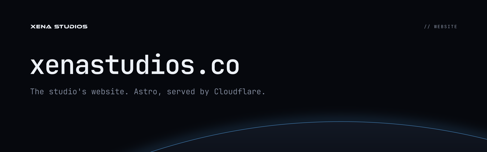

**The studio's website. Astro, served by Cloudflare.**

The one-page site at **[xenastudios.co](https://xenastudios.co)**. It's static [Astro](https://astro.build) and ships no JavaScript.

- [PRODUCT.md](PRODUCT.md): who the site is for and what it has to do
- [DESIGN.md](DESIGN.md): the visual system

## Develop

Needs Node 24 and pnpm.

```sh
pnpm install
pnpm dev        # http://localhost:4321
pnpm build      # type-check, then build to dist/
pnpm preview    # serve dist/
```

```
src/pages/        index (the home page), 404, sitemap.xml
src/layouts/      Base: <head>, header, footer
src/components/   Logo, Horizon, External (the outbound-link arrow)
src/styles/       global.css: tokens and type
src/brand/        synced from the brand repo, don't edit
public/           served as-is: _headers, _redirects, robots.txt, security.txt, icons
```

Add new pages to `src/pages/sitemap.xml.ts`.

## Brand assets

Logos, colours, the horizon and the icons come from [xena-studios/brand](https://github.com/xena-studios/brand). Change them there, then copy them in:

```sh
pnpm brand:sync    # expects the brand repo at ../brand, or set BRAND_DIR
```

Never set Ethnocentric (the logo font) as live text. Its licence only covers the outlined logos.

## Deploy

Pushing to `main` builds and deploys to the `xenastudios-website` Cloudflare Worker ([`deploy.yml`](.github/workflows/deploy.yml)). Pull requests only build. To redeploy without a commit, use **Run workflow** in the Actions tab.

- The Cloudflare token is in the `production` environment, which only `main` can use.
- To deploy from your machine: `pnpm exec wrangler login`, then `pnpm run deploy`.
- `public/_headers` sets a strict CSP: no scripts, and no inline styles.

## Maintenance

- `main` only takes pull requests, and `build` has to pass. CodeQL runs too, but isn't required.
- Renovate opens dependency PRs on Monday mornings.
- **`public/.well-known/security.txt` expires on 2027-10-22.** Move the date a year out before then.

## Design skill

`.agents/skills/impeccable` is the [Impeccable](https://github.com/pbakaus/impeccable) design skill (v4.7.0). It reads PRODUCT.md and DESIGN.md.

```sh
.agents/skills/impeccable/scripts/impeccable detect --json src   # scan for design problems
pnpm dlx impeccable update --project --yes --no-hooks             # update it
```

## Help

- **Something wrong on the site:** [open an issue](https://github.com/xena-studios/website/issues/new/choose)
- **Security:** follow the [security policy](https://github.com/xena-studios/.github/blob/main/SECURITY.md)
- **Anything else:** [contact@xenastudios.co](mailto:contact@xenastudios.co)

## Licence

All rights reserved: the source is public to read, not to reuse, so the repo doesn't take outside pull requests. The Impeccable skill is under Apache-2.0, and JetBrains Mono is under the SIL Open Font License.
