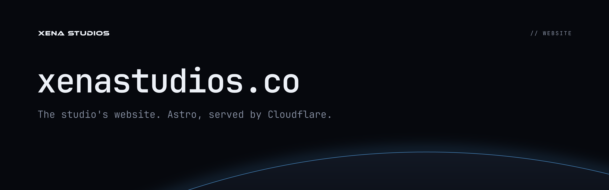

**The studio's website. Astro, served by Cloudflare.**

The Xena Studios website: a one-page static [Astro](https://astro.build) site served by Cloudflare at **[xenastudios.co](https://xenastudios.co)**.

The design comes from [xena-studios/brand](https://github.com/xena-studios/brand). Colours, logos, the horizon scene, the favicon and the link preview are synced from it, not redrawn here. [DESIGN.md](DESIGN.md) describes the visual system; [PRODUCT.md](PRODUCT.md) says who the site is for and what it must do.

## Develop

Needs Node 24.

```sh
npm install
npm run dev        # http://localhost:4321, with hot reload
npm run build      # static site in dist/
npm run preview    # serve dist/ locally
```

The site ships no JavaScript. Pages are Astro components rendered to HTML at build time.

## Layout

```
src/
  pages/
    index.astro        the home page: hero, Raptor, NeoSkript, plugins, how we work, contact
    404.astro          served for unknown paths
    sitemap.xml.ts     /sitemap.xml (add new routes to its list)
  layouts/Base.astro   <head>, header, footer
  components/
    Logo.astro         inlines a brand logo SVG in currentColor
    Horizon.astro      inlines the brand's horizon scene
    External.astro     the outbound-link arrow
  styles/global.css    tokens (from the brand), type scale, base styles
  assets/raptor/       Raptor's console screenshot (optimised to WebP at build)
  brand/               synced from xena-studios/brand: don't edit
public/                copied as-is: _headers, _redirects (/docs/* → docs.xenastudios.co), robots.txt,
                       .well-known/security.txt, favicon, apple-touch-icon, og.png
scripts/sync-brand.mjs copies brand assets in
.github/               workflows (deploy, CodeQL), the issue form, the pull request template, the README banner
```

Built CSS, fonts and images land in `dist/assets/` with content hashes.

## Brand assets

Everything in `src/brand/`, plus `public/favicon.svg`, `public/apple-touch-icon.png` and `public/og.png`, is copied from the brand repo. Change them there, then sync:

```sh
npm run brand:sync                        # expects the brand repo at ../brand
BRAND_DIR=/path/to/brand npm run brand:sync
```

`src/brand/SOURCE.json` records the brand commit the copies came from. The copies are committed, so a build never has to fetch the brand repo and the site only changes when someone syncs on purpose.

Ethnocentric, the logo typeface, only appears inside the brand's outlined logo SVGs. Its licence doesn't allow webfont use, so never set it as live text.

## Deploy

The Cloudflare Worker **`xenastudios-website`** serves `dist/` as static assets, with no Worker code: Cloudflare's successor to Pages, and the same setup as Raptor's site. It answers only on its custom domain, `xenastudios.co` (`www` redirects there), which was attached by hand, so the deploy token needs no DNS access. Configuration is in [`wrangler.jsonc`](wrangler.jsonc).

[`.github/workflows/deploy.yml`](.github/workflows/deploy.yml):

| Event | What happens |
|---|---|
| Push to `main` | Build, then deploy to xenastudios.co |
| **Run workflow** (Actions tab) | Redeploy `main` without a commit |
| Pull request | Build only, so a broken build can't merge unnoticed |

The `build` job runs on every event; the `deploy` job runs only on `main`, after `build` passes, in the **`production`** environment. Deploys use that environment's `CLOUDFLARE_API_TOKEN` secret (a token from the "Edit Cloudflare Workers" template, scoped to this account and the `xenastudios.co` zone) and the repo's `CLOUDFLARE_ACCOUNT_ID` variable, which isn't sensitive. To deploy from your machine instead: `npm run deploy` after `wrangler login`.

`public/_headers` sets a strict Content-Security-Policy (no scripts, no inline styles, same-origin assets only), the usual security headers, and a year of caching for the hashed files in `/assets/`. Because of that CSP, Astro is configured never to inline stylesheets or small assets.

## Checks and security

`main` takes changes only through pull requests: a ruleset blocks deleting it and force-pushing, and requires the `build` job above to pass. No review is required.

[`.github/workflows/codeql.yml`](.github/workflows/codeql.yml) runs CodeQL over the workflows and the site's TypeScript and scripts, with the security-extended queries, on every PR, every push to `main`, and weekly. Findings show on the PR and in the Security tab; it isn't a required check. Renovate opens dependency PRs on Monday mornings ([`renovate.json`](renovate.json), on top of the org's shared settings in [`xena-studios/.github`](https://github.com/xena-studios/.github/blob/main/renovate-config.json)), and keeps any third-party action pinned to a commit.

[`public/.well-known/security.txt`](public/.well-known/security.txt) points researchers to the org's [security policy](https://github.com/xena-studios/.github/blob/main/SECURITY.md); report problems privately through this repo's Security tab or to contact@xenastudios.co. Its `Expires` date is 2027-10-22: move it on (about a year out) before then.

The Cloudflare token lives in the `production` environment, which only `main` can use, so no branch or pull request can read it, even with an edited workflow. Within the deploy job, only the deploy step gets it, never `npm ci` or the build. Workflows get a read-only `GITHUB_TOKEN` unless they ask for more, and Actions can't approve pull requests.

Pages get a canonical URL without `.html` (`https://xenastudios.co/`, matching the sitemap); pass `noindex` to `Base` for a page that should stay out of search results, as the 404 page does.

## Design skill

`.agents/skills/impeccable` is the [Impeccable](https://github.com/pbakaus/impeccable) design skill (Apache-2.0, v4.7.0), used to build and review the site. It reads PRODUCT.md and DESIGN.md before any design work.

```sh
.agents/skills/impeccable/scripts/impeccable detect --json src   # scan for design anti-patterns
npx impeccable update --project --yes --no-hooks                  # update the skill
```

Its native engine (`scripts/bin/`) is installed per machine and isn't committed; the launcher downloads it on first run.

## Help

- **Something wrong on the site:** [open an issue](https://github.com/xena-studios/website/issues/new/choose). Problems with Raptor, NeoSkript or the plugins go to their own repositories.
- **Security problems:** privately, as the org's [security policy](https://github.com/xena-studios/.github/blob/main/SECURITY.md) describes.
- **Anything else:** [contact@xenastudios.co](mailto:contact@xenastudios.co).

Everyone taking part follows the [code of conduct](https://github.com/xena-studios/.github/blob/main/CODE_OF_CONDUCT.md). The site is all rights reserved, so it can't take outside pull requests: open an issue instead. The studio's own pull requests get a checklist from the template.

## Licence

All rights reserved. The site's code, design and brand assets are © Xena Studios and aren't licensed for reuse; the source is public so it can be read, not copied. The Impeccable skill in `.agents/` and the JetBrains Mono font keep their own licences (Apache-2.0 and the SIL Open Font License).
